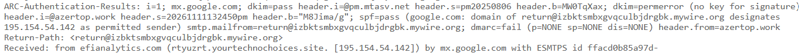
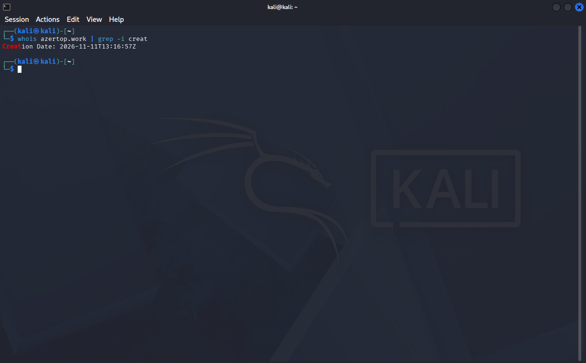
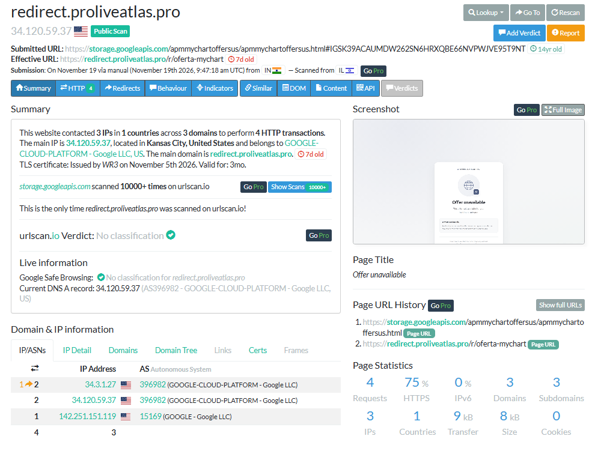

# PH-001: "Free Medicare Kit" email pretending to be MyChart

*Real phishing email from my own inbox. I never opened the link in a browser (I scanned it with urlscan.io). Personal data is removed and indicators are defanged.*

| | |
|---|---|
| **Message ID** | `<6af549f5.216d71ef.2cd01f.a712SMTPIN_ADDED_BROKEN@mx.google.com>` |
| **Created at** | Wed, Nov 11, 2026 at 7:00 PM (delivered after 56,322 seconds) |
| **Received** | Thu, Nov 12, 2026 at 10:39 AM |
| **From** | **MyChart** `<mypnwqbcwbdwnguhnnnk@azertop[.]work>` |
| **To** | `rczakkrmxubsofwgvyqk@azertop[.]work` |
| **Subject** | ✅ You've Been Selected for a FREE Medicare Kit today 🎁✔️ ____169 |
| **SPF** | PASS with IP `195.154.54[.]142` |
| **DKIM** | PASS with domain `pm[.]mtasv[.]net` |
| **DMARC** | FAIL |
| **Analyzed** | Nov 19, 2026 |
| **Verdict** | **Malicious**: phishing with brand impersonation and a reward lure |
| **MITRE ATT&CK** | T1566.002 (phishing link), T1583.001 (acquired domains) |

*Message details are from Gmail's "Show original" summary.*

## What happened

The email shows the sender name "MyChart" and pushes a free "Medicare kit" with a red button. There are no attachments. The button goes to a page the attacker set up on Google Cloud Storage, which sends you on to another domain that urlscan listed as about a week old.

## What I found

1. **The sender is not MyChart.** The name says MyChart, but the address is `mypnwqbcwbdwnguhnnnk@azertop[.]work`, a random string on an unrelated domain. The To field is another random address on the same domain, not mine, which suggests a bulk send with recipients BCC'd.
2. **The domain is brand new.** `azertop[.]work` was registered on Nov 11, the same day the email was created. On Nov 19 it had no SPF, DMARC, DKIM key, or A records.
3. **Authentication was broken.** SPF passed for the bounce subdomain `pm-bounces[.]azertop[.]work`, and DKIM passed only for the mail-delivery service's domain (`pm[.]mtasv[.]net`). The signature for `azertop[.]work` itself errored with "no key for signature", and Gmail reported **DMARC fail**. I could not determine the exact cause, because the domain's DNS records are gone.
4. **The link hides behind a trusted host.** Button, then a page on Google Cloud Storage, then a redirector at `proliveatlas[.]pro`, which showed "Offer unavailable" when scanned. urlscan and Google Safe Browsing flagged nothing, which is expected for infrastructure this new.

## Verdict and what I could not confirm

**Malicious.** It impersonates a brand, comes from a domain registered the same day it was sent, has broken authentication, hides behind a trusted host and a redirect, and offers a free reward.

I could not see what the final page does (credential theft, survey scam, something else). It showed "Offer unavailable" when I scanned it a week after delivery, so I make no claim about credential harvesting.

## Indicators (defanged)

| Type | Value |
|---|---|
| Sender address | `mypnwqbcwbdwnguhnnnk@azertop[.]work` |
| To address (attacker domain) | `rczakkrmxubsofwgvyqk@azertop[.]work` |
| Sender and bounce domains | `azertop[.]work`, `pm-bounces[.]azertop[.]work` |
| Sending IP | `195.154.54[.]142` (Scaleway, FR) |
| Landing URL | `hxxps://storage[.]googleapis[.]com/apmmychartoffersus/apmmychartoffersus[.]html` |
| Redirect URL | `hxxps://redirect[.]proliveatlas[.]pro/r/oferta-mychart` |
| Redirect domain | `proliveatlas[.]pro` (about 7 days old per urlscan) |
| Redirect IP | `34.120.59[.]37` (shared Google Cloud, so block the URL or domain, not the IP) |

## What I would do

1. Block `azertop[.]work` and the sender address at the mail gateway.
2. Search all mailboxes for the same sender or subject and delete matches.
3. Block `proliveatlas[.]pro` and the exact Google storage URL, not all of `googleapis.com`.
4. Check proxy and DNS logs for anyone who visited either link. Reset passwords for anyone who entered credentials.
5. Report the storage bucket to Google Cloud and the domains to their registrars.

**Detection idea:** flag emails where the display name is a known brand but the sending domain is not, especially when the domain is less than 30 days old.

## Limits of this analysis

- The page I scanned on Nov 19 may not match what recipients saw on Nov 12, since the attacker controls it.
- Domain and IP details reflect the day I checked and may change or disappear.

## Commands I ran (Kali)

```bash
whois azertop.work | grep -i creat     # Creation Date: 2026-11-11T13:16:57Z
dig TXT azertop.work +short            # no output
dig TXT _dmarc.azertop.work +short     # no output
dig TXT 20261111132450pm._domainkey.azertop.work +short   # no output
dig A azertop.work +short              # no output
whois 195.154.54.142 | head -30        # Scaleway, FR
```

## Screenshots




